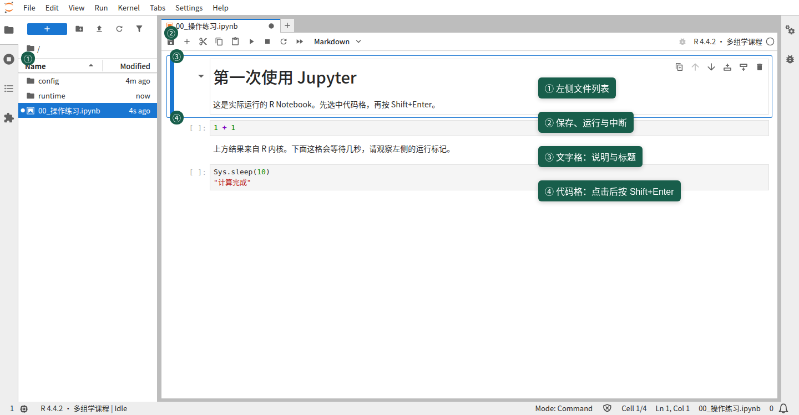
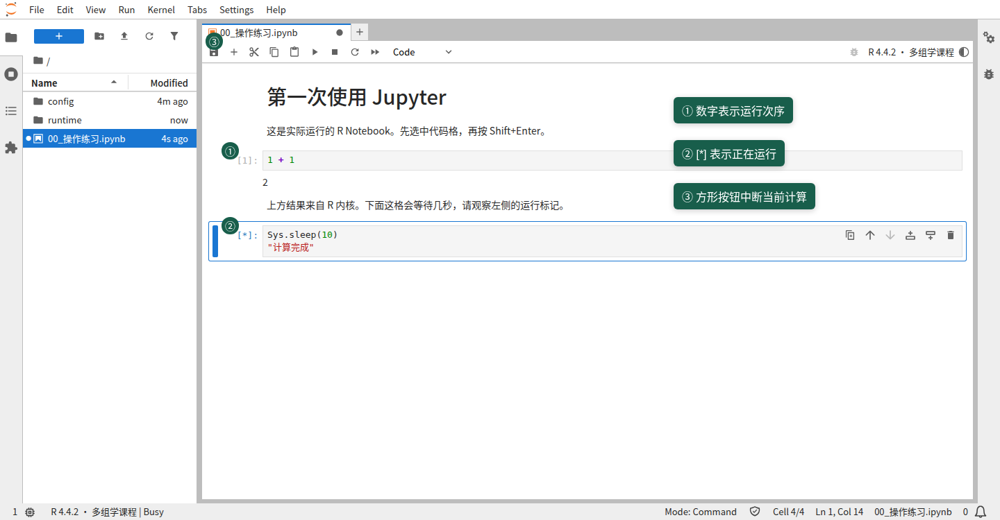

这节起步课大约需要 **15–20 分钟**。你会在浏览器里打开课程、运行几段 R 代码、修改一张图，并练习保存、重开和处理常见状态。课程包已经带好运行环境，不用另外安装 R 或 Jupyter。

## 1. 打开可运行的 Notebook（约 2 分钟）

解压课程包后，打开其中的“运行课程”入口（Windows 使用 `.bat`，Mac 使用 `.command`）。浏览器打开 Jupyter 后，在课程文件夹中打开 `00_start.ipynb`。这是可以编辑和运行代码的 Notebook。

打开后，先单击下面的初始化代码格，按 **Shift+Enter**。它会设置课程环境，通常不会显示表格；左侧出现运行编号就表示完成。后面的示例使用 R 自带的函数和数据，不需要安装新包。

```{r setup}
roots <- c(getwd(), file.path(getwd(), ".."))
root <- roots[file.exists(file.path(roots, "teaching.Rproj"))][1]
if (is.na(root)) stop("请从课程文件夹或 notebooks 文件夹打开本 Notebook。")
source(file.path(root, "R", "notebook_support.R"))
course_init("00", root = root)
```

### 检查当前课堂环境

运行后检查 `passed` 列。内置课程使用 R 4.4.2；缺少包或工具时，请重新解压完整课程包。电脑上已有的其他 R 不需要修改。

```{r system_check}
course_self_check()
```


课程还提供 HTML 预览页。HTML 适合直接阅读，里面已有的代码和结果是静态内容；想改代码并重新运行，请打开 `.ipynb`。默认情况下，每份 Notebook 都有自己的 R 内核；同一份 Notebook 的各个代码格共享变量，新打开的 Notebook 通常有独立的变量和运行状态。



## 2. 认识代码格和 Markdown 格（约 3 分钟）

Notebook 由一格一格的单元组成。**代码格**里写 R，运行后结果会显示在代码下方；**Markdown 格**用来写标题、说明和链接，不会当作 R 执行。可以从工具栏的单元类型选择框把当前格设为 Code 或 Markdown。

Jupyter 有两种常见操作状态：在**命令模式**下，单元格整体被选中，可以移动、运行或更改单元类型；按 `Enter` 进入**编辑模式**，光标出现在格内，可以修改文字。按 `Esc` 可回到命令模式。插入或删除单元前，先确认自己处在哪种模式。



先点选下面的代码格，按 `Enter`，在格内把 `1 + 1` 改成 `2 + 3`，再运行。按 **Shift+Enter** 会运行当前格并选中下一格；按 **Ctrl+Enter** 会运行当前格并留在原处；也可以点工具栏的运行按钮。Mac 键盘上如果 `Ctrl+Enter` 不方便使用，直接点工具栏运行按钮即可。

```{r}
1 + 1
```

格子左侧的提示会显示它的状态：`[ ]` 表示这格尚未运行，`[*]` 表示正在运行，`[1]` 这样的数字表示已经完成，数字是本内核中的运行次序。运行一次上面的 `1 + 1`，看看提示如何变化。

## 3. 运行、修改和重跑（约 4 分钟）

R 可以先把结果存进一个变量，再在后面的代码格里使用它。运行下面两格，确认第二格显示 `2`：

```{r}
answer <- 1 + 1
```

```{r}
answer
```

变量只会在它所属的 Notebook 内核中存在。若你修改了上游代码，例如把 `answer <- 1 + 1` 改成 `answer <- 4 + 1`，后面的格子不会自动重算；请先重跑赋值格，再重跑使用 `answer` 的格子。想让整个 Notebook 按顺序重新运行，可从第一格开始逐格运行。

## 4. 看一张表，再改图的颜色（约 4 分钟）

`iris` 是 R 自带的示例数据。运行下面的代码格，会看到几行花朵测量数据：

```{r}
head(iris)
```

先运行这一格设置三种花的颜色：

```{r}
iris_colors <- c("steelblue", "orange", "darkgreen")
```

再运行下一格画出萼片长度和花瓣长度的关系。每个点代表一朵花；颜色区分三种鸢尾花：

```{r}
plot(iris$Sepal.Length, iris$Petal.Length,
     col = iris_colors[iris$Species], pch = 19,
     xlab = "Sepal length", ylab = "Petal length")
legend("topleft", legend = levels(iris$Species),
       col = iris_colors, pch = 19)
```

试着把 `iris_colors` 这一格中的 `"orange"` 改成 `"firebrick"`，只重跑这一格，再重跑画图格。颜色由上游变量提供，所以要重跑画图格才会看到变化。你也可以改 `pch = 19` 里的数字，观察点的形状如何变化。

## 5. 保存、另存副本和重新打开（约 3 分钟）

按 **Ctrl+S** 保存；Mac 使用 **Cmd+S**。若要保留自己的练习版本，可用 **File → Save Notebook As** 另存副本，再给副本取一个容易辨认的名字。另存后请留意 Jupyter 当前打开的是哪个 Notebook。

只关闭浏览器标签页或 Notebook 文件时，如果对应的内核仍在运行，变量通常还留在内核里。关闭 Jupyter 服务或重启内核后，R 内存状态会清空。重新打开保存的 Notebook 时，已保存的代码和输出仍可能显示，但这些输出不能恢复变量；内核重启后先运行初始化格，再按需要重跑后续代码。默认情况下，新打开的 Notebook 使用独立内核；若课程运行环境被人工配置为共享内核，行为可能不同。

## 6. 清输出、重启和中断有什么不同（约 2 分钟）

这三个操作解决的问题不同：

- **清除输出**只移除格子下方显示的结果，不负责重新计算，也不清空当前内核里的变量。
- **Kernel → Restart Kernel**重新启动当前 Notebook 的 R 内核，变量会清空；需要再次运行初始化格和之后要用的代码。已保存到文件中的代码不会被删除。
- 工具栏上的**方形 Stop 按钮**会尝试中断正在运行的代码。它用于停止当前运算，不等同于重启；如果运算已改动变量，检查状态后再决定是否重跑相关代码。

先运行下面这格，观察左侧变成 `[*]`，大约五秒后它会自行结束：

```{r}
Sys.sleep(5)
"等待结束，代码已继续运行。"
```

## 7. 手动试一次错误，并完成自测（约 2–3 分钟）

为让本页默认顺序运行保持正常，下面的错误示例不会作为可执行格运行。想认识错误提示时，请**手动新建一个代码格**，输入下面这行并单独运行：

```r
print(missing_value)
```

你会看到类似 `object 'missing_value' not found` 的错误。再手动新建一格，输入并运行 `missing_value <- 3`，然后回到刚才的格子重跑；这次会显示 `3`。错误示例只在你手动创建的格子里，不会进入本页默认运行流程。

完成下面的自测：

1. 重新运行 `answer <- 1 + 1`，并运行下一格，确认结果是 `2`。
2. 把 `iris_colors` 中的 `"orange"` 换成 `"firebrick"`，重跑颜色格和散点图格，确认图的颜色改变。
3. 保存 Notebook 后关掉标签页再打开，确认代码和已保存输出还在；再区分内核仍运行和服务/内核已关闭时变量的状态。
4. 确认你能说出清除输出、重启内核和方形 Stop 按钮分别做什么。

如果新建的练习格留下了错误输出，可以将它删除或清除输出。准备结束时，在 Jupyter 选择 **File → Shut Down** 关闭服务；若启动器打开的运行窗口仍在，也可以切回该窗口按 **Ctrl+C**，并在提示时确认退出。不要只关浏览器标签页。

## 结果保存在哪里

本页不额外生成文件。后续课程若要保存练习结果，会把 `lesson_output()` 返回的目录显示出来；本页的输出目录也可用下面的代码查看。课程包模式下，结果位于 `课程资源/work/results/00_start/`。

```{r}
out <- lesson_output("00_start")
out
```

## 结果快照和新建课程副本

下面两个辅助函数供后续课程或教师演示使用。此处只是说明，不要运行它们：`course_fresh_notebook('01')` 会返回一份新建副本的路径，不覆盖原 Notebook；`course_snapshot('baseline',settings=list())` 会返回结果快照的路径。起步课不需要用它们创建额外 Notebook。

## 接下来怎样读懂 R 代码

后面的章节会先解释分析目的，再给出代码和结果阅读提示。遇到不熟悉的符号，可以打开[代码阅读速查](assets/reading_guide.html)：先辨认对象是表、矩阵还是向量，再看代码取了哪一部分数据，最后看返回了什么结果。

标有“展开看”的说明默认收起，里面解释语法或进一步的原理；可以按需要打开。可运行的代码格始终放在说明外面，按原来的顺序执行即可。

## 后续章节的运行时间

各章标注了默认代码在测试机上的耗时，供安排等待时间。测试机使用 Intel(R) Xeon(R) Platinum 8336C CPU @ 2.30GHz，Linux、R 4.4.2，计算线程设为 2；这些时间不包含阅读、操作和首次解压环境。

## 课程导航

预览页可直接阅读；需要运行时，请在 Jupyter 中打开对应的 `.ipynb`。同目录也提供 `.Rmd` 源文件。

| 课程 | 内容 | Notebook | R Markdown | 预览 |
|---|---|---|---|---|
| 01 | Bulk RNA-seq | [ipynb](01_bulk.ipynb) | [Rmd](01_bulk.Rmd) | [HTML](01_bulk.nb.html) |
| 02 | 单靶点 MR | [ipynb](02_single_mr.ipynb) | [Rmd](02_single_mr.Rmd) | [HTML](02_single_mr.nb.html) |
| 03 | 蛋白组发现与验证 | [ipynb](03_proteome_mr.ipynb) | [Rmd](03_proteome_mr.Rmd) | [HTML](03_proteome_mr.nb.html) |
| 04 | 敏感性分析 | [ipynb](04_sensitivity.ipynb) | [Rmd](04_sensitivity.Rmd) | [HTML](04_sensitivity.nb.html) |
| 05 | SMR 与 HEIDI | [ipynb](05_smr.ipynb) | [Rmd](05_smr.Rmd) | [HTML](05_smr.nb.html) |
| 06 | 共定位 | [ipynb](06_colocalization.ipynb) | [Rmd](06_colocalization.Rmd) | [HTML](06_colocalization.nb.html) |
| 07 | 单细胞 | [ipynb](07_single_cell.ipynb) | [Rmd](07_single_cell.Rmd) | [HTML](07_single_cell.nb.html) |
| 08 | 靶点遗传评分 | [ipynb](08_pgs.ipynb) | [Rmd](08_pgs.Rmd) | [HTML](08_pgs.nb.html) |
| 09 | Cox 生存分析 | [ipynb](09_cox.ipynb) | [Rmd](09_cox.Rmd) | [HTML](09_cox.nb.html) |
| 10 | 功能与药物关联 | [ipynb](10_functional.ipynb) | [Rmd](10_functional.Rmd) | [HTML](10_functional.nb.html) |
| 11 | 相关疾病 MR | [ipynb](11_clinical_mr.ipynb) | [Rmd](11_clinical_mr.Rmd) | [HTML](11_clinical_mr.nb.html) |
| 12 | 综合证据 | [ipynb](12_evidence.ipynb) | [Rmd](12_evidence.Rmd) | [HTML](12_evidence.nb.html) |
