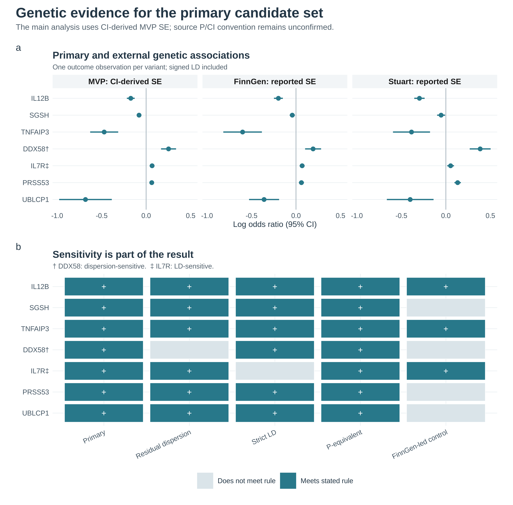
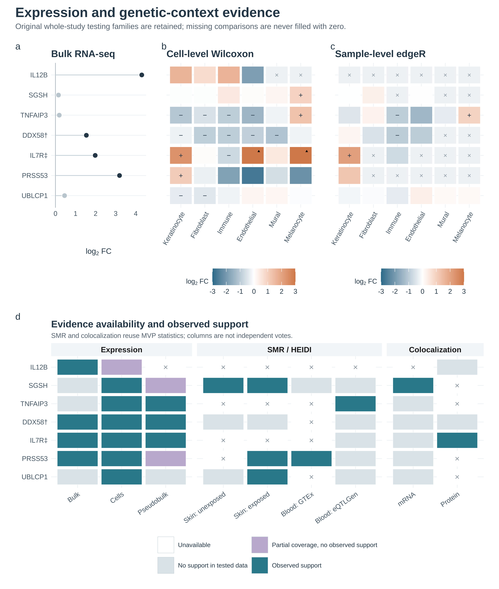
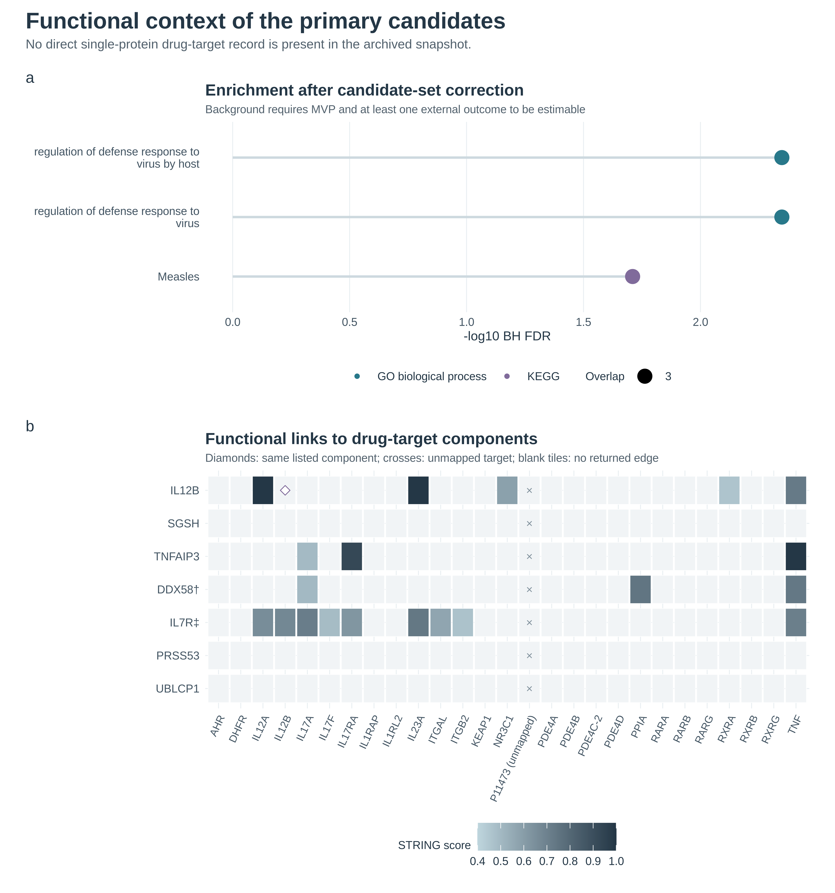
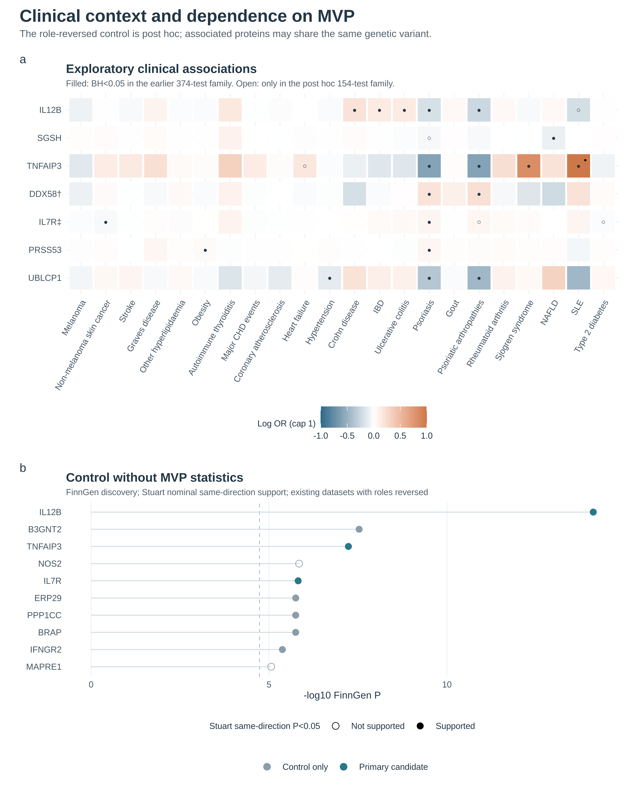

# Figure captions

## F01_genetic_evidence

a, Fixed-effect generalized IVW and both external outcomes, with one GWAS estimate per unique variant and reference LD. b, Each column applies its stated discovery and external-support rule. The FinnGen-led column uses no MVP statistics but reuses existing outcome datasets. Symbols identify DDX58 sensitivity to residual dispersion and IL7R sensitivity to strict LD. P-equivalent analysis adds ICAM3 outside this fixed primary set. These markers are not an evidence score or a claim of validated causal targets. Gene markers: dagger indicates DDX58 residual-dispersion sensitivity; double dagger indicates IL7R strict-LD sensitivity.

## F02_expression_and_coverage

a, Integer-count bulk reconstruction (90 lesions, 81 controls); dark points meet the original full-gene significance rule. DDX58 is mapped by GeneID 23586 to the source symbol RIGI. b-c, Six broad cell types; +/minus marks FDR<0.05 and absolute log2FC>0.25, crosses are undefined or untested, and corner triangles mark clipping at +/-3. Pseudobulk units are GEO subject labels; the original study reports 14 patients. d, Support and coverage under the recorded bulk, cell, SMR/HEIDI and H4>0.8 rules. Partial coverage is separate from complete tested nonsupport. SMR/colocalization share MVP outcome statistics and are not independent confirmation. Gene markers: dagger indicates DDX58 residual-dispersion sensitivity; double dagger indicates IL7R strict-LD sensitivity.

## F03_functional_context

a, All terms with BH FDR<0.05 after rerunning enrichment on the primary candidate set; all eligible terms, including zero overlap, enter the appropriate GO or KEGG family. Protein-level opportunity background is 2,045, followed by unique-gene and annotation filtering. b, Exact induced graph from the archived STRING v12.5 query, not a new API response. IL12B has complex-component drug records; these and network links do not establish direct drug binding or efficacy. P11473 is unmapped and explicitly retained. Blank mapped pairs have no returned edge above 0.4. Gene markers: dagger indicates DDX58 residual-dispersion sensitivity; double dagger indicates IL7R strict-LD sensitivity.

## F04_clinical_and_MVP_free

a, Primary candidates across the fixed 22 FinnGen R12 endpoints. Filled circles retain BH from the earlier reconstruction of 374 comparisons; open circles indicate significance only under the new 154-comparison exploratory family. Color saturates at +/-1 with corner squares marking clipping. Two phenotype proxies retain their approved definitions. b, All FinnGen Bonferroni discoveries at the unchanged 2,709 denominator, with Stuart same-direction nominal support and primary-set membership indicated. FinnGen/Stuart were already used elsewhere; this is not a new independent replication. ERP29, PPP1CC and BRAP share a frozen outcome variant, so protein counts are not counts of independent loci. Gene markers: dagger indicates DDX58 residual-dispersion sensitivity; double dagger indicates IL7R strict-LD sensitivity.

